<div align="center">

<!-- HERO BANNER -->


<br />

<!-- ANIMATED TYPING HEADLINE -->
<a href="https://github.com/SAIVINAY983">
  
</a>

<p align="center">
  I am a passionate Full Stack Developer focused on building scalable web applications,<br />
  secure backend systems, and intelligent AI-powered solutions.
</p>

<!-- PRIMARY CONTACT & SOCIAL LINKS -->
<p align="center">
  <a href="https://github.com/SAIVINAY983">
    
  </a>
  <a href="mailto:billakantisaivinay943@gmail.com">
    
  </a>
  
</p>

</div>

---

## About Me

<table>
  <tr>
    <td width="55%" valign="top">
      <br />
      <ul>
        <li><strong>Education:</strong> B.Tech in Computer Science &amp; Engineering at <strong>Lovely Professional University</strong> (Class of <strong>2027</strong>).</li>
        <li><strong>Focus:</strong> End-to-end Full Stack Development — from responsive React &amp; TypeScript interfaces to production REST APIs.</li>
        <li><strong>Engineering Interests:</strong> Backend architecture, role-based access control, relational &amp; NoSQL data modeling, real-time systems, and applied AI integration.</li>
        <li><strong>Approach:</strong> Shipping practical, tested software products while continuously sharpening system design and problem-solving fundamentals.</li>
      </ul>
    </td>
    <td width="45%" valign="top">

```ts
const engineer = {
  name: "B Sai Vinay",
  handle: "SAIVINAY983",
  role: "Full Stack Developer & Software Engineer",
  education: "B.Tech CSE · LPU '27",
  coreStack: ["React", "TypeScript", "Node.js", "Django"],
  databases: ["MongoDB", "PostgreSQL", "MySQL"],
  exploring: ["System Design", "AI Agents", "Real-Time Apps"]
};
```

  </td>
  </tr>
</table>

---

## Tech Stack

<div align="center">

<table>
  <tr>
    <th align="left" width="170">Category</th>
    <th align="left">Technologies</th>
  </tr>
  <tr>
    <td><strong>Frontend</strong></td>
    <td>
      
    </td>
  </tr>
  <tr>
    <td><strong>Backend</strong></td>
    <td>
      
      &nbsp;
      
    </td>
  </tr>
  <tr>
    <td><strong>Database</strong></td>
    <td>
      
    </td>
  </tr>
  <tr>
    <td><strong>Programming</strong></td>
    <td>
      
      &nbsp;
      
    </td>
  </tr>
  <tr>
    <td><strong>Tools</strong></td>
    <td>
      
    </td>
  </tr>
  <tr>
    <td><strong>Auth, Realtime &amp; AI</strong></td>
    <td>
      
      
      
      
    </td>
  </tr>
</table>

</div>

---

## Featured Projects

### Core Engineering Showcase

<table>
  <tr>
    <td width="50%" valign="top">
      <h3>01 · GateVault</h3>
      <a href="https://github.com/SAIVINAY983/GateVault">
        
      </a>
      <p>
        <strong>Smart Parcel Verification &amp; Handover Platform</strong> for gated communities featuring a zero-trust digital chain of custody.
      </p>
      <ul>
        <li>Role-based dashboards for Residents, Security Guards, and Admins</li>
        <li>Dual pickup verification via 6-digit dynamic PIN &amp; HMAC-SHA256 QR pass</li>
        <li>Google OAuth 2.0 onboarding, shelf capacity alerts, incident logs &amp; PDF/Excel reporting</li>
        <li>Backed by 394 automated test assertions</li>
      </ul>
      <p>
        <code>React 19</code> <code>Vite</code> <code>Django REST Framework</code> <code>SimpleJWT</code> <code>Channels</code> <code>PostgreSQL</code>
      </p>
      <p>
        <a href="https://github.com/SAIVINAY983/GateVault"></a>
        <a href="https://gate-vault-self.vercel.app/"></a>
      </p>
    </td>
    <td width="50%" valign="top">
      <h3>02 · ArchMind</h3>
      <p>
        <strong>AI-Powered System Design &amp; Architecture Generator</strong> converting project requirements into interactive visual architecture workflows.
      </p>
      <ul>
        <li>Transforms natural-language system requirements into structured architecture diagrams</li>
        <li>Interactive node-based canvas powered by React Flow for inspecting and refining components</li>
        <li>Full-stack REST backend integrating OpenAI for automated architecture synthesis</li>
      </ul>
      <p>
        <code>React</code> <code>Vite</code> <code>React Flow</code> <code>Node.js</code> <code>Express</code> <code>OpenAI</code>
      </p>
      <p>
        <a href="https://github.com/SAIVINAY983/Archmind"></a>
        <a href="https://archmind-gamma.vercel.app/"></a>
      </p>
    </td>
  </tr>
  <tr>
    <td width="50%" valign="top">
      <h3>03 · PulseRoute</h3>
      <p>
        <strong>AI-Based Multi-Ambulance Priority &amp; Traffic Recovery System</strong> simulating real-time emergency dispatch and corridor coordination.
      </p>
      <ul>
        <li>Deterministic 100-point priority engine (clinical severity, ETA, distance, wait time) with 5-tier tie-breaking</li>
        <li>Corridor conflict detection for competing ambulances and two-stage traffic signal recovery</li>
        <li>7-stage emergency lifecycle timeline &amp; real-time Server-Sent Events (SSE) notifications</li>
        <li>In-app QA verification runner (20+ assertions) &amp; Node.js test suites</li>
      </ul>
      <p>
        <code>React 18</code> <code>Vite</code> <code>Node.js</code> <code>Express</code> <code>MongoDB</code> <code>SSE</code> <code>JWT</code>
      </p>
      <p>
        <a href="https://github.com/SAIVINAY983/PulseRoute"></a>
        <a href="https://pulse-route-sage.vercel.app/"></a>
      </p>
    </td>
    <td width="50%" valign="top">
      <h3>04 · Grama Vidya</h3>
      <p>
        <strong>Rural Education Learning Management System (LMS)</strong> built to deliver accessible, mobile-first digital classrooms.
      </p>
      <ul>
        <li>Role-based dashboards for Students, Teachers, and Administrators</li>
        <li>Course &amp; lesson management supporting video uploads, YouTube embeds, and PDF notes</li>
        <li>Student progress tracking, community discussion forum, and Gemini 2.5 Flash integration</li>
      </ul>
      <p>
        <code>React</code> <code>Tailwind CSS</code> <code>Vite</code> <code>Node.js</code> <code>Express</code> <code>MongoDB</code> <code>JWT</code>
      </p>
      <p>
        <a href="https://github.com/SAIVINAY983/Grama-vidya"></a>
        <a href="https://grama-vidya.vercel.app/"></a>
      </p>
    </td>
  </tr>
  <tr>
    <td width="50%" valign="top">
      <h3>05 · Udyog Saarthi</h3>
      <p>
        <strong>Accessible Job-Coaching &amp; Inclusive Hiring PWA</strong> supporting adults preparing for opportunities under the 4% PWD reservation.
      </p>
      <ul>
        <li>AI-powered resume builder with PDF export &amp; voice/text interview simulator</li>
        <li>Accessible job board, guided learning hub, and high-contrast / simple UI modes</li>
        <li>Employer hiring portal and trainer coaching analytics backed by Laravel 11 &amp; MongoDB Atlas</li>
      </ul>
      <p>
        <code>React</code> <code>Tailwind CSS</code> <code>Laravel 11</code> <code>Sanctum</code> <code>MongoDB Atlas</code> <code>Docker</code>
      </p>
      <p>
        <a href="https://github.com/SAIVINAY983/Udyog-Saarthi"></a>
        <a href="https://udyog-saarthi.vercel.app/"></a>
      </p>
    </td>
    <td width="50%" valign="top">
      <h3>06 · CryptoPal Oracle Pro</h3>
      <p>
        <strong>AI-Powered Crypto Portfolio &amp; Sentiment Platform</strong> combining live asset tracking with NLP market intelligence.
      </p>
      <ul>
        <li>Real-time portfolio valuation, 7-day sparklines, Buy/Sell history &amp; Net Worth charts</li>
        <li>NLP news sentiment analysis (<code>sentiment</code>) generating Bullish/Bearish market signals</li>
        <li>Multi-currency converter, JWT authentication, and NodeMailer email recovery</li>
      </ul>
      <p>
        <code>React 18</code> <code>TypeScript</code> <code>Tailwind</code> <code>Shadcn UI</code> <code>Express</code> <code>Prisma</code> <code>MongoDB</code>
      </p>
      <p>
        <a href="https://github.com/SAIVINAY983/Crypto_tracker"></a>
        <a href="https://crypto-tracker-three-amber.vercel.app/"></a>
      </p>
    </td>
  </tr>
</table>

### Additional Product & Platform Builds

| Project | Overview | Stack | Links |
| :--- | :--- | :--- | :--- |
| **InvestIQ** | AI investment research agent combining Yahoo Finance, Tavily Web Search &amp; Gemini 1.5 Flash into structured equity reports. | `React` `Tailwind CSS` `Node.js` `Express` `LangChain` `Gemini` | [Repo](https://github.com/SAIVINAY983/InvestIQ) · [Live](https://invest-iq-peach.vercel.app/) |
| **FundsRoom** | Mini ERP &amp; CRM portal with role-based access (`ADMIN`, `SALES`, `WAREHOUSE`, `ACCOUNTS`) and atomic Prisma stock transactions. | `React` `TypeScript` `Node.js` `Express` `Prisma` `PostgreSQL` | [Repo](https://github.com/SAIVINAY983/Fund_room) · [Live](https://fund-room-fdas.vercel.app/) |
| **HumanDocs** | Real-time collaborative cloud document editor with Socket.IO live cursors and Gemini 2.5 Flash AI writing assistant. | `React` `Tailwind CSS` `Node.js` `Socket.IO` `MongoDB` `Gemini AI` | [Repo](https://github.com/SAIVINAY983/HumanDocs) · [Live](https://human-docs-drab.vercel.app/dashboard) |
| **Campus Chaos** | Real-time multiplayer party game (2–8 players) featuring Speed Quiz, Bluff or Bank, and Memory Blitz modes. | `React 18` `TypeScript` `Vite` `Netlify Functions` `Netlify Blobs` | [Repo](https://github.com/SAIVINAY983/Campus-Chaos-) · [Live](https://campus-chaos-last-player-standing.netlify.app/) |
| **BiteAI (Bit)** | Smart wellness companion featuring AI meal logging, animated calorie/mood analytics, workout tracking, and XP challenges. | `React` `Redux Toolkit` `Tailwind` `Framer Motion` `Express` `MongoDB` | [Repo](https://github.com/SAIVINAY983/bit) · [Live](https://bit-sigma-steel.vercel.app/) |
| **Crypto Currency Chatbot** | JavaScript-based cryptocurrency chatbot companion (`crypto-currency-chatbot`). | `JavaScript` | [Repo](https://github.com/SAIVINAY983/crypto-currency-chatbot) |

---

## GitHub Analytics

<div align="center">

<p>
  
  &nbsp;
  
</p>

<p>
  
</p>

<p>
  
</p>

</div>

---

## Certifications

| Credential | Issuer / Program | Highlight |
| :--- | :--- | :--- |
| **Oracle AI Foundation** | Oracle | AI & Machine Learning Fundamentals |
| **Cloud Computing** | NPTEL | **Elite + Silver** |
| **Developer Job Simulation** | Accenture | Software Engineering & Architecture |
| **Front-End Job Simulation** | Skyscanner | UI Engineering & React |
| **MERN Stack Certification** | GeeksforGeeks | Full Stack Web Development |
| **Responsive Web Design** | freeCodeCamp | HTML5, CSS3 & Accessible Layouts |

---

<div align="center">

## Connect

Open to **Software Engineering** and **Full Stack Developer** internships and product engineering roles.

<p>
  <a href="https://github.com/SAIVINAY983">
    
  </a>
  <a href="mailto:billakantisaivinay943@gmail.com">
    
  </a>
</p>


</div>
